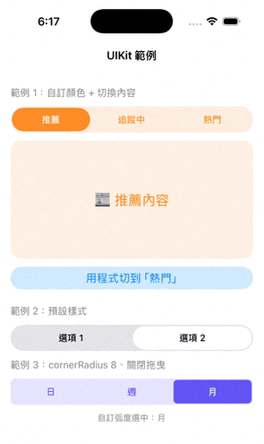

# CapsuleSegmentKit

[English](README.md) | 繁體中文

[](https://github.com/dorothyTao5/CapsuleSegmentKit/actions/workflows/ci.yml)

可自訂兩側弧度、顏色與數量，並支援拖曳切換的 SwiftUI 膠囊分段控制元件。

<p align="center">
  
</p>

## 功能

- **兩側弧度可自訂**：預設為半圓（膠囊形），也可指定圓角半徑；超過高度一半時自動限制為半圓
- **支援 SF Symbols**：每個項目可以顯示圖示加文字，也可以只顯示圖示
- **顏色可自訂**：背景、選中 segment、文字、選中文字
- **數量彈性**：預設 2 個項目，可傳入任意數量
- **點擊與拖曳切換**：按住選中的 segment 左右拖曳，放開後以彈簧動畫吸附到最近的選項
- **觸覺回饋**：在 iPhone 上切換時有輕微震動，可關閉
- **支援 SwiftUI 與 UIKit**：UIKit 透過 `UIHostingController` 使用，附完整範例
- **無第三方依賴**

## 文件

完整的英文文件（包含 Getting Started 教學）在
[dorothytao5.github.io/CapsuleSegmentKit](https://dorothytao5.github.io/CapsuleSegmentKit/documentation/capsulesegmentkit/)。

## 安裝

### Swift Package Manager

在 Xcode 選 **File → Add Package Dependencies…**，輸入：

```
https://github.com/dorothyTao5/CapsuleSegmentKit
```

或在 `Package.swift` 中加入：

```swift
dependencies: [
    .package(url: "https://github.com/dorothyTao5/CapsuleSegmentKit", from: "1.0.0")
]
```

## 使用方式

### SwiftUI

```swift
import SwiftUI
import CapsuleSegmentKit

struct ContentView: View {
    @State private var selectedIndex = 0

    var body: some View {
        // 預設：2 個項目、兩側半圓
        CapsuleSegmentControl(selectedIndex: $selectedIndex)
            .padding()
    }
}
```

自訂項目、顏色與弧度：

```swift
CapsuleSegmentControl(
    selectedIndex: $selectedIndex,
    items: ["推薦", "追蹤中", "熱門"],
    backgroundColor: .orange.opacity(0.15),
    selectedSegmentColor: .orange,
    textColor: .orange,
    selectedTextColor: .white,
    cornerRadius: 8          // nil = 半圓（預設）
)
```

只允許點擊、關閉拖曳：

```swift
CapsuleSegmentControl(
    selectedIndex: $selectedIndex,
    items: ["日", "週", "月"],
    isDragEnabled: false
)
```

### SF Symbols

傳入 `CapsuleSegmentItem`，就能在標題旁邊顯示 SF Symbol：

```swift
CapsuleSegmentControl(
    selectedIndex: $selectedIndex,
    items: [
        CapsuleSegmentItem("列表", systemImage: "list.bullet"),
        CapsuleSegmentItem("格狀", systemImage: "square.grid.2x2"),
    ]
)
```

只顯示圖示時，加上 `.labelStyle(.iconOnly)`。VoiceOver 仍然會唸出每個項目的標題。

```swift
CapsuleSegmentControl(
    selectedIndex: $selectedIndex,
    items: [
        CapsuleSegmentItem("白天", systemImage: "sun.max"),
        CapsuleSegmentItem("夜晚", systemImage: "moon"),
    ]
)
.labelStyle(.iconOnly)
```

### UIKit

把元件包在 `UIHostingController` 裡，就能像一般的 view controller 一樣加入畫面。完整的橋接程式在 [`CapsuleSegmentHostingController.swift`](Examples/CapsuleSegmentUIKitExample/CapsuleSegmentUIKitExample/CapsuleSegmentHostingController.swift)，可直接複製到你的專案。

```swift
let segment = CapsuleSegmentHostingController(items: ["進行中", "已完成"])
addChild(segment)
view.addSubview(segment.view)          // 再加上 Auto Layout，高度 40
segment.didMove(toParent: self)

segment.onSelectionChanged = { index in print(index) }   // 點擊或拖曳都會通知
segment.selectedIndex = 1                                 // 用程式切換
```

## 參數

| 參數 | 類型 | 預設值 | 說明 |
|------|------|--------|------|
| `selectedIndex` | `Binding<Int>` | 必填 | 選中的索引 |
| `items` | `[String]` 或 `[CapsuleSegmentItem]` | `["Option 1", "Option 2"]` | 項目標題，可加上 SF Symbol |
| `backgroundColor` | `Color` | `Color.gray.opacity(0.2)` | 背景顏色 |
| `selectedSegmentColor` | `Color` | `.white` | 選中 segment 的顏色 |
| `textColor` | `Color` | `.primary` | 未選中的文字顏色 |
| `selectedTextColor` | `Color` | `.primary` | 選中的文字顏色 |
| `cornerRadius` | `CGFloat?` | `nil` | 兩側圓角半徑，`nil` 為半圓 |
| `segmentInset` | `CGFloat` | `2` | 選中 segment 與背景邊緣的間距 |
| `height` | `CGFloat` | `40` | 元件高度 |
| `font` | `Font` | `.system(size: 14, weight: .medium)` | 文字字型 |
| `isDragEnabled` | `Bool` | `true` | 是否允許拖曳切換 |
| `hapticFeedback` | `Bool` | `true` | 切換時是否有觸覺回饋 |

## 範例專案

| 範例 | 執行方式 | 內容 |
|------|----------|------|
| [`CapsuleSegmentUIKitExample`](Examples/CapsuleSegmentUIKitExample) | 打開 `.xcodeproj`，選 iPhone 模擬器，按 ⌘R | UIKit 中的三種使用情境 |
| [`CapsuleSegmentDemo`](Examples/CapsuleSegmentDemo) | 打開套件，scheme 選 `CapsuleSegmentDemo`、目標選 My Mac，按 ⌘R | 即時調整所有參數的測試畫面 |

單元測試：打開套件，scheme 選 `CapsuleSegmentKit`，按 ⌘U。

## 系統需求

- iOS 17.0+ / macOS 14.0+ / tvOS 17.0+ / watchOS 10.0+ / visionOS 1.0+
- Xcode 26+（Swift 6.2）

## 授權

MIT License，詳見 [LICENSE](LICENSE)。
